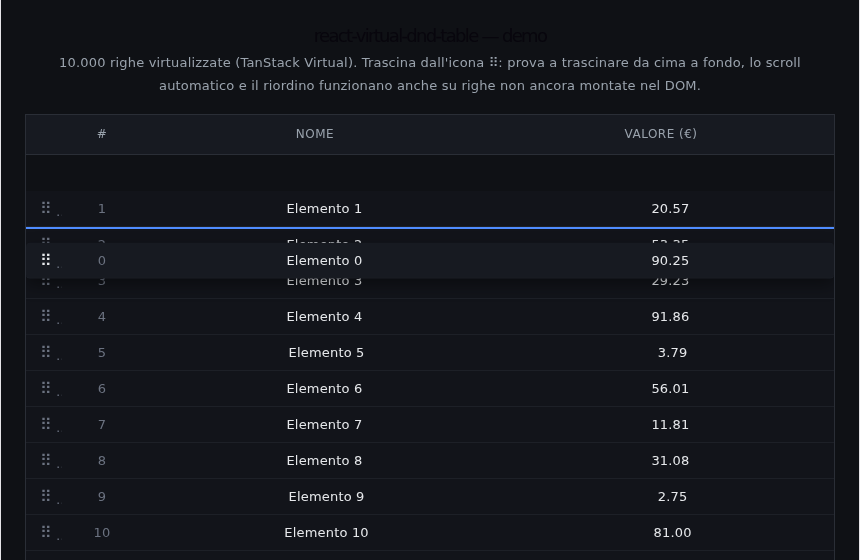

# react-virtual-dnd-table

[](https://github.com/Utumno1984/react-virtual-dnd-table/actions/workflows/ci.yml)
[](https://www.npmjs.com/package/react-virtual-dnd-table)
[](./LICENSE)

Drag-to-reorder for virtualized row lists — the piece [TanStack Table's own docs](https://tanstack.com/table/latest/docs/framework/react/guide/virtualization) leave for you to figure out.

**[Live demo →](https://react-virtual-dnd-table.vercel.app)** (10,000 rows, try dragging past the viewport)



<video src="./docs/demo.webm" controls muted width="720">
  Your viewer doesn't render inline video — see <a href="./docs/demo.webm">docs/demo.webm</a>.
</video>

## The problem

[dnd-kit](https://dndkit.com/) is the de-facto drag-and-drop library for React, and its `SortableContext` works great — as long as every item you might drop onto is actually mounted in the DOM. Virtualize your rows (with [TanStack Virtual](https://tanstack.com/virtual/latest), `react-window`, or anything else), and that assumption breaks: dnd-kit can only detect a collision with a row that's currently rendered, so you can't drop onto a row that's scrolled off-screen.

TanStack Table's own virtualization guide is explicit about this: the table owns rows/columns/state, the virtualizer owns scroll offsets, and wiring drag-and-drop across the two is left as an exercise for the reader.

## The fix

Don't ask dnd-kit "what element is the pointer over." Compute it yourself: `pointer delta ÷ row height`, in the same coordinate space the virtualizer already uses. That works whether or not the target row happens to be mounted, and it comes with a small auto-scroll loop so dragging near the edge of the viewport keeps revealing new rows.

That's the whole package: one headless hook, `useVirtualRowReorder`, that plugs into dnd-kit's `<DndContext>` and tells you `activeIndex` / `overIndex` as plain numbers. No opinion on how your rows render, what UI kit you use, or which table library (if any) sits on top.

## Install

```bash
npm install react-virtual-dnd-table @dnd-kit/core
```

## Usage

```tsx
import { DndContext, useDraggable } from "@dnd-kit/core";
import { useVirtualRowReorder } from "react-virtual-dnd-table";

const ROW_HEIGHT = 36;

function MyVirtualizedList({ items, setItems, scrollRef }) {
  const { activeIndex, overIndex, sensors, onDragStart, onDragMove, onDragEnd, onDragCancel } =
    useVirtualRowReorder({
      count: items.length,
      rowHeight: ROW_HEIGHT,
      getScrollElement: () => scrollRef.current,
      onReorder: (from, to) => setItems((prev) => arrayMove(prev, from, to)),
    });

  return (
    <DndContext
      sensors={sensors}
      autoScroll={false} // this hook drives its own, virtualization-aware auto-scroll
      onDragStart={onDragStart}
      onDragMove={onDragMove}
      onDragEnd={onDragEnd}
      onDragCancel={onDragCancel}
    >
      {/* render only your virtualizer's visible rows, each with: */}
      {/* useDraggable({ id: virtualRow.index }) — the row's CURRENT index, not a stable id */}
    </DndContext>
  );
}
```

Full working example (TanStack Table + TanStack Virtual, 10,000 rows): [`packages/demo`](./packages/demo).

Full API reference: [`packages/react-virtual-dnd-table/README.md`](./packages/react-virtual-dnd-table/README.md).

## Limitations (v0.1, by design — PRs welcome)

- Fixed row height only. Variable-height virtualization would need the hook to read offsets from your virtualizer instead of a constant.
- No built-in visual "shift" of the rows between the drag's start and current position — you get `activeIndex`/`overIndex` and decide how to render the gap (the demo just shows an insertion line).
- Vertical lists only.

## Try the demo locally

```bash
git clone https://github.com/Utumno1984/react-virtual-dnd-table.git
cd react-virtual-dnd-table
npm install
npm run dev
```

## License

MIT © Daniele Ingusci
